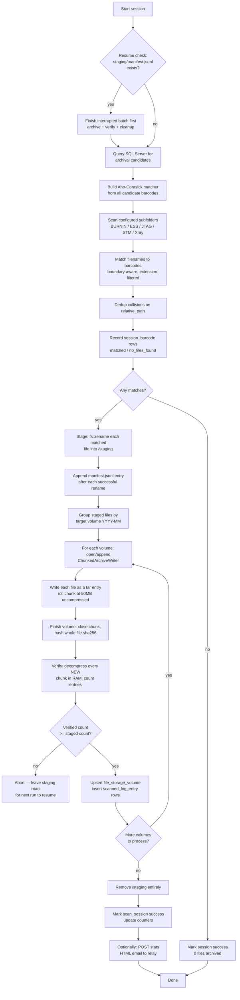
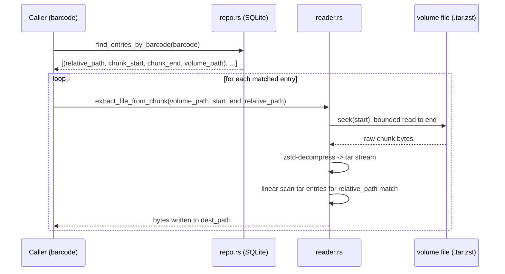
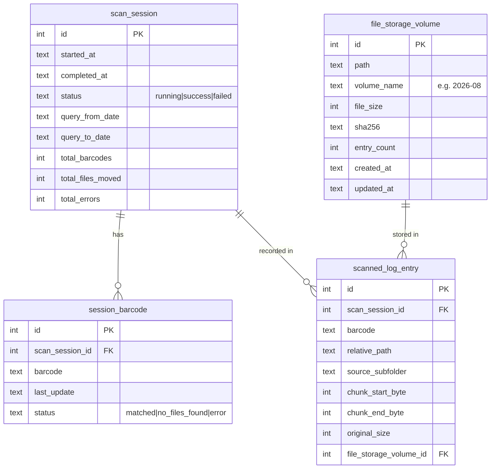

# Log Archiver — `archiver_core` Documentation

This document describes the design, data flow, and module-by-module
behavior of the `archiver_core` Rust crate: a tool that finds log
files matching barcodes queried from SQL Server, packs them into
chunked, compressed `.tar.zst` volumes organized by month, and
indexes their exact byte locations in a local SQLite database for
fast later retrieval.

- **43 automated tests** across the crate (`src/` inline tests +
  `tests/phase*.rs` integration tests).
- Crash-safe by design: a process kill at any point during a run
  leaves either fully-archived data or fully-recoverable staged
  data — never a file that exists nowhere.

---

## 1. High-Level Flow



**Crash-safety invariant:** a file only ever exists in one place at a
time — either still in the source tree, or in `/staging`, or inside a
verified `.tar.zst` volume. `/staging` is only deleted after *every*
touched month's volume has been independently re-decompressed and
counted. If a crash happens mid-archive, the next run detects the
leftover `staging/manifest.jsonl` and finishes that batch (step C)
before doing anything else.

---

## 2. Module Map

| Module | Responsibility |
|---|---|
| `writer.rs` | Chunked `.tar.zst` volume writer (the archive engine) |
| `reader.rs` | Reads chunks/volumes back out — extraction, listing, preview |
| `schema.rs` | SQLite schema (4 tables) for the offset index |
| `repo.rs` | Typed CRUD over the SQLite index |
| `matcher.rs` | Boundary-aware Aho-Corasick barcode matching in filenames |
| `db.rs` | SQL Server (Tiberius) query for archival candidates + resume-window math |
| `session.rs` | Orchestrates the full scan → stage → archive → verify → cleanup flow |
| `secure_config.rs` | AES-256-GCM encrypted-at-rest storage for SQL Server connection settings |
| `email_report.rs` | Builds and POSTs an HTML statistics summary after a run |
| `error.rs` | Unified `ArchiveError` enum + `Result` alias used everywhere |

Dependency direction: `session.rs` is the only module that pulls all
the others together. Everything else is usable independently (e.g.
`reader.rs` has no dependency on `session.rs`, so a UI's file-browser
tab can extract from a volume without going through a session at
all).

---

## 3. The Archive Format — `writer.rs` / `reader.rs`

Each monthly volume (`2026-08.tar.zst`) is **not** a single zstd
frame wrapping a single tar stream. It's a sequence of independent
**chunks**, concatenated in one file:

```
[ chunk 1: zstd frame { tar stream + EOF footer } ]
[ chunk 2: zstd frame { tar stream + EOF footer } ]
[ chunk 3: zstd frame { tar stream + EOF footer } ]
...
```

- A new chunk starts when the previous one is empty (lazy — no chunk
  is opened until the first file needs one) and rolls over once
  **50MB of uncompressed data** (`CHUNK_SIZE_THRESHOLD`) has been
  written into it (checked *after* each file, not pre-emptively).
- Every chunk gets its own tar end-of-archive footer (two 512-byte
  zero blocks) and its own finished zstd frame — this is what makes
  a chunk **independently decompressible**: seek to `chunk_start_byte`,
  read `chunk_end_byte - chunk_start_byte` bytes, zstd-decompress,
  and you have a standalone valid `.tar` any standard tool can open.
- Reading the **whole file** as one continuous stream instead (e.g. to
  browse every file in a volume) requires `tar --ignore-zeros`,
  because plain `tar` stops at the first chunk's own footer. zstd
  itself decodes concatenated frames back-to-back automatically — no
  special handling needed on that side. `reader::open_volume_as_tar`
  sets `archive.set_ignore_zeros(true)` to do this correctly.
- **Appending to an existing volume** never rewrites earlier bytes —
  `open_or_append` opens the file in append mode and simply starts
  writing new chunks after whatever's already there.
- **Integrity:** on `finish()`, the whole volume file is SHA-256
  hashed (`hash_file`) — re-hashed in full on every append, since
  there's no incremental shortcut, matching the spec's requirement
  to recompute `file_size`/`sha256`/`entry_count` on the
  `file_storage_volume` row after every append.
- **Compression level:** `clamp_compression_level` asks the linked
  zstd library for its actual supported range (`zstd::compression_level_range()`)
  and clamps a requested level into it, so a stale/hand-edited config
  value degrades gracefully instead of failing the run. Positive
  values (1–22) are the standard trade-off range; negative values are
  zstd's "fast" mode (same as the CLI's `--fast=N` flag, level `-N`).

### Reading a chunk back — the extraction path



Locating the **chunk** is O(1) (a direct byte-offset seek from the
SQLite index). Locating the **member within the chunk** is a linear
scan of that chunk's tar entries, so overall extraction is
O(entries-in-chunk), not O(1) per file — a chunk holds ≤50MB
uncompressed worth of files, so this stays fast in practice.

`reader.rs` also exposes a **whole-volume path** (no SQLite index
needed) for browsing an old or orphaned `.tar.zst` directly:
`list_volume_entries`, `extract_entry_from_volume`,
`extract_all_from_volume`, and `preview_entry_from_volume` (bounded
in-memory read, for previewing a file without extracting to disk)
all linearly scan every chunk in the file.

---

## 4. The SQLite Offset Index — `schema.rs` / `repo.rs`

Four tables, schema taken verbatim from spec:



Key constraints:
- `session_barcode` is `UNIQUE(barcode, last_update)` — this is the
  dedup mechanism across runs. `repo::record_session_barcode` treats
  a constraint violation as `Ok(None)`, not an error.
- `scanned_log_entry` is `UNIQUE(relative_path, file_storage_volume_id)`
  — a given path can only be recorded once per volume. Because of
  this, `session.rs` explicitly dedups matched files by
  `relative_path` **before** staging (see §5) so a collision never
  reaches this constraint mid-transaction.
- `file_storage_volume.entry_count` is the volume's **cumulative**
  total across every session that ever appended to it — `repo::upsert_volume`
  takes a caller-computed cumulative count, not a per-call delta.

`repo::record_finished_volume` wraps the whole "upsert volume + insert
every entry" step in a single SQLite transaction.

---

## 5. Session Orchestration — `session.rs`

This is the largest module and the one that wires everything else
together. Its steps, in order:

1. **Resume check.** If `staging/manifest.jsonl` already exists (a
   previous run staged files but crashed before archiving them),
   that batch is finished first — archived, verified, and cleaned up
   — before any new query or scan happens. This guarantees at most
   one unarchived staged batch ever exists at a time.
2. **Start session row** (`scan_session`, status `running`).
3. **Build the matcher** from *every* candidate barcode returned by
   the DB query for the window — not just ones not yet recorded in
   `session_barcode`. This matters: a barcode already recorded from
   an earlier run (e.g. its BURNIN file was found) must still be
   matchable now if its STM file only shows up in this run. The
   "already scanned" check is only used later, to avoid re-inserting
   a duplicate `session_barcode` row.
4. **Scan** each configured subfolder (`BURNIN`, `ESS`, `JTAG`, `STM`,
   `Xray`). For each file: filter by allowed extension, run the
   boundary-aware Aho-Corasick matcher (a match must be flanked by
   `_`, `.`, `-`, or string start/end — see §6), and if exactly one
   barcode matches, resolve the target month from that barcode's
   *retrieved date* (not today's date) via `volume_name_from_date`.
   - A missing subfolder or a directory-read error is logged and
     counted as an error, not fatal to the rest of the scan.
   - A filename matching **more than one** barcode is treated as an
     error (ambiguous) and skipped.
5. **Dedup by `relative_path`.** Two matched files that would resolve
   to the same staged path (e.g. same filename, same subfolder) keep
   only the first; the rest are counted as errors. This is what
   prevents the SQLite `UNIQUE(relative_path, file_storage_volume_id)`
   constraint from ever failing mid-transaction.
6. **Record `session_barcode` statuses** for every fresh candidate
   (`matched` or `no_files_found`), batched inside a single
   transaction (avoids one disk sync per row at scale — relevant at
   ~200k+ candidates per run).
7. **Stage.** For each matched file: `fs::rename` it from the source
   tree into `/staging/<subfolder>/<filename>`, then immediately
   append its entry to `manifest.jsonl` (see §7). Recording only
   *after* the rename succeeds is what keeps the manifest an accurate
   record of what's actually on disk in staging.
8. **Archive + verify + cleanup** — delegated to `finish_staged_batch`
   (shared with the resume path in step 1):
   - Group staged entries by target volume (`YYYY-MM`).
   - For each volume: open/append a `ChunkedArchiveWriter`, write
     every staged file as a tar entry, `finish()` the writer (closes
     the chunk, hashes the file).
   - **Verify** every *newly written* chunk by decompressing it in
     RAM and counting entries (`verify_chunk_in_ram`). If the
     verified count is less than the staged count for that volume,
     the whole session aborts *without deleting staging* — the next
     run will find the manifest and retry.
   - Upsert `file_storage_volume` and insert `scanned_log_entry` rows
     for every verified entry.
   - Only after **every** touched volume passes verification is
     `/staging` removed in its entirety.
9. **Complete the session row** (status `success`, final counters).

### Multi-volume-per-run handling

A single scan can match barcodes from different months (e.g. an
August scan finding both July-dated and August-dated logs). Each
month gets its own independently opened/verified `.tar.zst` —
`finish_staged_batch` loops over a `BTreeMap<volume_name, entries>`
and only deletes staging after the *entire* map has been processed
successfully.

---

## 6. Barcode Matching — `matcher.rs`

Uses `aho-corasick` in **overlapping match mode**
(`MatchKind::Standard` + `find_overlapping_iter`), not
`LeftmostLongest`. This matters because `LeftmostLongest` silently
drops a shorter valid barcode match whenever a longer candidate
starts at the same position — a real bug caught and fixed during
development.

A match only counts if it's **boundary-delimited**: the character
immediately before and after the match must be one of `_`, `.`, `-`,
or the start/end of the filename. This stops `BC123` from spuriously
matching inside `BC1234567` when both are valid barcodes in the
candidate set.

```
unit1_BC123_log.txt
      └─┬─┘
   boundary-delimited by '_' on both sides -> valid match
```

Extension filtering (`has_matching_extension`) is a simple
case-insensitive suffix check against the configured allow-list
(e.g. `.txt`, `.zip` — `Xray`'s `.zip` files are included
deliberately, not just `.txt` logs).

---

## 7. Crash Safety — `manifest.jsonl`

`staging/manifest.jsonl` is the durability record for "what's
currently in `/staging` and why." It's a flat file, deliberately
**not** a DB table, because it must survive independent of the
SQLite index (a crash could happen between a staging move and any DB
write at all).

Format: append-only, line-delimited JSON.

```
{"scan_session_id": 42}
{"relative_path":"BURNIN/unit1_BC001_log.txt","source_subfolder":"BURNIN","barcode":"BC001","original_size":18234,"volume_name":"2026-08"}
{"relative_path":"ESS/unit2_BC002_log.txt","source_subfolder":"ESS","barcode":"BC002","original_size":9021,"volume_name":"2026-07"}
...
```

- **Header line** (`scan_session_id`) is written once, before any
  file is staged.
- **One line per file**, appended immediately after that file's
  `fs::rename` into staging succeeds — never written ahead of time.
- **Flushed every 500 entries** (`StagingManifestWriter::FLUSH_EVERY`)
  and once more when staging finishes. This bounds a crash's blast
  radius to at most ~500 staged-but-unrecorded files, while avoiding
  an fsync per file.
- **On read**, a missing or corrupt header means "nothing safe to
  resume" (treated as no manifest, not an error). A truncated final
  line (a flush caught mid-crash) is skipped rather than failing the
  whole read — the file it describes was never confirmed staged
  anyway.

### Orphaned session ID recovery

Because the manifest persists a `scan_session_id` independent of the
SQLite index, that ID can go stale if the index DB is ever reset,
replaced, or repointed while a manifest sits in staging.
`finish_staged_batch` checks `repo::session_exists` first — if the ID
no longer exists, it starts a **fresh** `scan_session` for the
resumed batch instead of blindly passing the orphaned ID through
(which would otherwise fail the `scanned_log_entry` foreign key on
every retry with no way to recover).

---

## 8. SQL Server Query — `db.rs`

```sql
SELECT DISTINCT
    sfs.serial_no AS BARCODE,
    CONVERT(VARCHAR(50), sft.last_update, 120) AS last_update
FROM ForthUtilities.dbo.ShipmentFinisarSerial sfs WITH (NOLOCK)
JOIN ForthUtilities.dbo.ShipmentFinisarTrace sft WITH (NOLOCK)
    ON sfs.trace_id = sft.trace_id
WHERE sft.last_update >= '<from>' AND sft.last_update < '<to_date>';
```

(`from` clause omitted entirely on the first-ever run, when there's
no prior successful scan to resume from.)

- **Connection settings** (`DbConfig`) load either from the encrypted
  on-disk store (`secure_config`, the normal path once the UI's
  Settings tab has been used) or from environment variables
  (`DbConfig::from_env`, kept for headless/scripted use and initial
  setup) — never hardcoded.
- **Retry with exponential backoff:** `retry_base_delay * 2^attempt`,
  up to `retry_attempts` retries, on any connection or query failure.
- **Resume window** (`compute_resume_window`): `from = last successful
  scan's query_to_date − 1 day`, `to = today − lookback_days`. Date
  arithmetic is hand-rolled (Howard Hinnant's civil-calendar
  algorithms) specifically to avoid pulling in `chrono` as a
  dependency.

---

## 9. Encrypted Connection Settings — `secure_config.rs`

SQL Server credentials, once entered via the UI's Settings tab, are
encrypted at rest with **AES-256-GCM**:

- A random 256-bit key is generated once (`db_key.bin`) and never
  changes — regenerating it would make any previously saved
  `db_config.enc` permanently undecryptable.
- On-disk layout of `db_config.enc`: `[12-byte random nonce][ciphertext + auth tag]`.
  The nonce isn't secret; GCM only requires it never repeat under the
  same key, which a fresh random nonce per save satisfies.
- Both the key file and the config file are written with **owner-only
  permissions** (mode `0600` on Unix), set *at file creation*, not
  chmod'd after the fact — so there's no window where either file is
  briefly world-readable.
- `load()` returns `Ok(None)` (not an error) when no config has been
  saved yet — the UI should render a blank Settings form for this
  case, not an error state.
- **Known limitation:** this is a local encrypted keyfile scheme, not
  OS-keychain integration (the `keyring` crate hit the same
  edition2024/D-Bus MSRV wall that blocked `rfd`/Slint during UI
  development — see the project's own build README for the full
  story). Documented as an accepted tradeoff, not a silent gap.

---

## 10. Post-Session Email Report — `email_report.rs`

After a session finishes, the caller (the UI's worker thread) can
build a `SessionStats` struct and POST a compact HTML summary to an
internal, unauthenticated relay:

```
POST {api_base_url}/api/email/send
Content-Type: application/json

{ "to": "...", "subject": "...", "body": "<html>...</html>" }
```

- Speaks raw HTTP/1.1 over a plain TCP socket (no external HTTP
  client crate) — appropriate given the relay is a trivial internal
  `http://` endpoint with no TLS and a single fixed route.
- **Hard size budget:** the rendered HTML body is kept under 95,000
  bytes (spec requires <100KB). The two sections that can grow
  without bound on a large run — the per-volume archive breakdown
  table and the unmatched-barcode list — are shrunk iteratively
  (whichever is currently larger loses half its row cap first) until
  the whole body fits; a hard truncation on a UTF-8 char boundary is
  the last-resort fallback.
- All dynamic content (barcodes, error messages) is HTML-escaped.
- Sending is **best-effort and non-blocking** to the session itself —
  a failed email never fails or delays the archiving path it's
  reporting on.

---

## 11. Error Handling — `error.rs`

A single `ArchiveError` enum (via `thiserror`) covers every failure
mode across the crate — I/O (with the offending path attached),
tar/zstd stream errors, SQLite errors, SQL Server errors,
configuration errors, a duplicate-scan case, a "no matching entry
found" case for extraction, and email-relay errors. `From` impls
exist for `rusqlite::Error` and `tiberius::error::Error` so `?`
propagates cleanly from either driver. A single `Result<T>` alias is
used as the return type throughout the crate.

---

## 12. Dependencies

| Crate | Purpose |
|---|---|
| `tar` | tar stream construction/reading |
| `zstd` | streaming compression/decompression, frame-based chunking |
| `sha2` | whole-volume SHA-256 integrity hashing |
| `rusqlite` (bundled) | SQLite offset index |
| `aho-corasick` | multi-pattern barcode matching in filenames |
| `tokio` + `tiberius` + `tokio-util` | async SQL Server connectivity |
| `serde` / `serde_json` | manifest + encrypted-config (de)serialization |
| `aes-gcm` (pinned `=0.10.3`) | AES-256-GCM encryption for connection settings |
| `thiserror` | the `ArchiveError` enum |
| `tempfile` (dev) | test-only temp directories/files |

---

## 13. Test Coverage Summary

| Test file | Focus | Count |
|---|---|---|
| `tests/phase1_chunking.rs` | Chunk rollover, footer correctness, real zstd/tar round-trip | 5 |
| `tests/phase2_index.rs` | Schema, upsert-on-append, transactional insert | 6 |
| `tests/phase3_extraction.rs` | Byte-diff verified extraction by barcode | 2 |
| `tests/phase4_db_and_matching.rs` | Query builder, resume-window date math, matcher boundary logic | 10 |
| `tests/phase5_session_flow.rs` | Crash-mid-archive-then-rerun (no loss/duplication) | 2 |
| `tests/phase6_file_viewer.rs` | Whole-volume listing/extraction/preview | 4 |
| `tests/secure_config.rs` | Round-trip, tamper detection, wrong-key rejection | 8 |
| `src/email_report.rs` (inline) | Size-budget shrinking, escaping | 3 |
| `src/session.rs` (inline) | Orphaned-session-id recovery | 3 |
| **Total** | | **43** |

> **Note:** SQL Server connectivity (`db.rs`'s live connection path)
> is compile-verified only — no reachable SQL Server instance exists
> in the build/test sandbox. The query builder and resume-window math
> around it are unit tested independently of an actual connection.
