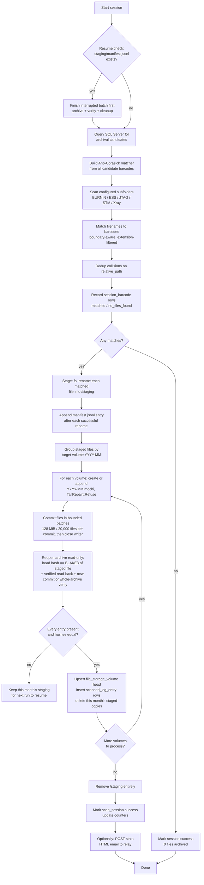
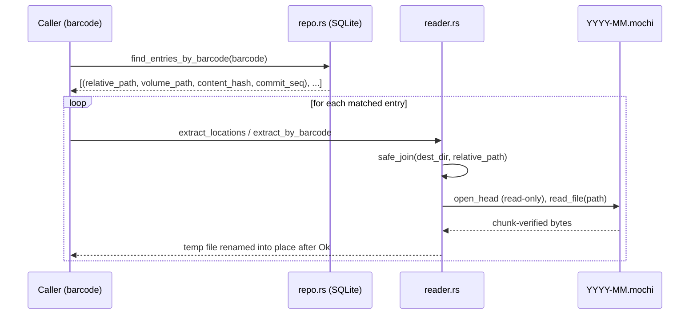
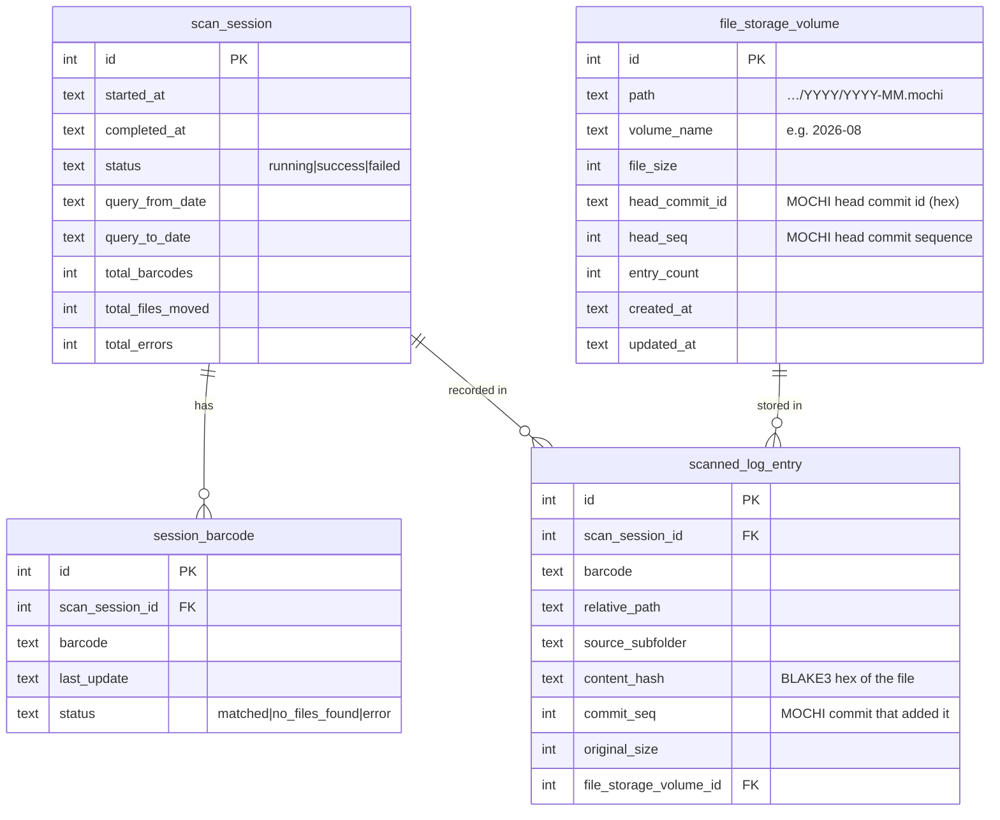

# Log Archiver — `archiver_core` Documentation

This document describes the design, data flow, and module-by-module
behavior of the `archiver_core` Rust crate: a tool that finds log
files matching barcodes queried from SQL Server, commits them into
monthly [MOCHI](https://github.com/immerh8/MOCHI) archives
(`YYYY-MM.mochi`, via the `mochi-core` library), and indexes each
file's archive path, content hash and commit in a local SQLite
database for fast later retrieval.

- **69 automated tests** in `archiver_core` (`src/` inline tests +
  `tests/*.rs` integration tests), plus 2 in the `ui` crate.
- Built for **200,000–300,000+ small files per run**: work is spread over
  worker threads and every step is linear in the file count (see
  [§14 Performance at scale](#14-performance-at-scale)).
- Crash-safe by design: a process kill at any point during a run
  leaves either fully-committed data or fully-recoverable staged
  data — never a file that exists nowhere.
- **Wording:** a successful write is *committed (`LOCAL_COMMITTED`)*:
  one local archive file was synced. That is **not** a backup. Keep an
  independent copy of the output folder (and of the SQLite index).

---

## Desktop UI (`ui/`, Tauri 2)

A [Tauri](https://tauri.app) app: Rust commands on the back, a plain
HTML/CSS/JS page on the front (no npm, no bundler). Every action draws
a live **execution-flow diagram** so the operator sees exactly which
step is running, what it is doing and how far along it is.


| File | Role |
|---|---|
| `ui/src/main.rs` | App setup, registers commands |
| `ui/src/commands.rs` | `#[tauri::command]`s: settings, search, extract, volume viewer |
| `ui/src/pipeline.rs` | The archive / dry run; emits `progress` events `{ step, message, done, total }` |
| `ui/src/settings.rs` | Persisted `settings.json` |
| `ui/frontend/` | `index.html`, `styles.css`, `app.js` — tabs, flow diagram, activity log |

Build: `cargo build -p ui --release` (on Windows the WebView2 runtime is
required; it ships with Windows 10/11). On Linux, install
`libwebkit2gtk-4.1-dev` first.

---

## 1. High-Level Flow



**Crash-safety invariant:** a file only ever exists in one place at a
time — either still in the source tree, or in `/staging`, or inside a
committed and verified `.mochi` archive. `/staging` is only deleted
after *every* touched month's archive has been re-opened read-only and
every staged file found in its head with a BLAKE3 hash equal to the
staged file's. If a crash happens mid-archive, the next run detects the
leftover `staging/manifest.jsonl` and finishes that batch (step C)
before doing anything else.

---

## 2. Module Map

| Module | Responsibility |
|---|---|
| `mochi_store.rs` | Monthly MOCHI archive writer: create-or-append, byte-bounded commits, hashing, read-only verification |
| `par.rs` | Small std-only scoped worker pool (ordered results, progress ticks on the calling thread) |
| `reader.rs` | Reads `.mochi` volumes back out (via `mochi-core`) — extraction, listing, preview, safe path joining |
| `schema.rs` | SQLite schema (4 tables, `user_version` 2) for the index |
| `repo.rs` | Typed CRUD over the SQLite index |
| `matcher.rs` | Boundary-aware Aho-Corasick barcode matching in filenames |
| `db.rs` | SQL Server (Tiberius) query for archival candidates + resume-window math |
| `session.rs` | Orchestrates the full scan → stage → archive → verify → cleanup flow |
| `secure_config.rs` | AES-256-GCM encrypted-at-rest storage for SQL Server connection settings |
| `email_report.rs` | Builds and POSTs an HTML statistics summary after a run |
| `error.rs` | Unified `ArchiveError` enum + `Result` alias used everywhere |

Dependency direction: `session.rs` is the only module that pulls all
the others together. Everything else is usable independently (e.g.
`reader.rs` has no dependency on `session.rs`, so a UI's file-browser
tab can extract from a volume without going through a session at
all).

---

## 3. The Archive Format — `mochi_store.rs` / `reader.rs`

Storage is delegated to **MOCHI** (`mochi-core`, pinned to commit
`733a21bd2a841fe7ab198137fa89b3439fe20ac1`, 0.9.6). A `.mochi` file is
an append-only chain of **commits**; every commit is a full snapshot of
a namespace of files and directories, hash-anchored with BLAKE3. The
program keeps the same *what/how* as before — only the container
changed:

- **One archive per month**, named from the barcode's retrieved date:
  `<output_dir>/<YYYY>/<YYYY-MM>.mochi`.
- **In-archive paths** are the matcher's `relative_path`:
  `<SUBFOLDER>/<filename>` (`BURNIN/unit1_BC001_log.txt`). The subfolder
  gets an explicit directory entry (`put_dir`) the first time it is
  needed (MOCHI requires a file's parent to exist in the head or in the
  same commit).
- Each file is stored with its modification time (staged files keep the
  mtime of the source file because staging is an `fs::rename`).

```
2026/2026-08.mochi
  commit 0   BURNIN/            (dir)
             BURNIN/unit1_BC001_log.txt
             ESS/ ...
  commit 1   (a later session appended more files to the same month)
  ...
```

### Writing — create or append

`mochi_store::store_volume(archive_path, &[StoreFile])`:

1. If `YYYY-MM.mochi` does not exist, it is created with
   `ArchiveWriter::create_in` (never replaces anything). Otherwise it is
   opened with `ArchiveWriter::open_append_in(.., TailRepair::Refuse)`.
   Both use `OsIds` and `WriterOptions { record_time: true, .. }` — the
   default profile: in-archive deduplication on, MOCHI's own Zstandard
   chunking (we do **not** compress anything ourselves, so there is no
   compression-level setting any more).
2. **Bounded commits.** The month's staged files are split into commits of
   at most `COMMIT_BYTE_BUDGET` (**1 GiB**) and `COMMIT_FILE_BUDGET`
   (**20,000 files**). Each commit is one `LOCAL_COMMITTED` snapshot; a
   crash loses at most the commit in progress (the next run skips what
   was already committed, see *Idempotency*).
   **Content:** every file is streamed into the writer with
   `Transaction::put_file_from`, one chunk at a time, so no file is held in
   memory whole. MOCHI 0.9.11 reads, hashes and compresses the content on
   worker threads ahead of the writer (`WriterOptions::threads`, set to the
   archiver's per-month worker count so two months written at once do not
   oversubscribe the CPU); the archive is the same bytes for any thread
   count. 0.9.11 also streams small files as cheaply as in-memory ones
   (0.9.10 zero-filled an 8 MiB buffer per file, which is why the archiver
   used to read small files into memory itself).
   **Peak memory:** MOCHI's in-flight chunks, about `2 × threads` pieces of
   at most 8 MiB plus their frames per month being written.
   **Linear cost:** the head namespace is replayed once per call, not once
   per commit, and the content hashes MOCHI computed while writing are
   read from the catalog afterwards (no separate hashing pass).
3. The writer is closed with `close()` to release the archive's
   single-writer lock; the head `commit_id` and `seq` are returned.

Errors are mapped into `ArchiveError`: every `MochiError` becomes
`ArchiveError::Mochi { code, message }` with MOCHI's stable
`code.as_str()`; two codes get dedicated variants with clear text:
`LOCK_CONFLICT` → `ArchiveLocked` (another writer holds the archive;
MOCHI fails fast and never waits — retry the run) and `UNCOMMITTED_TAIL`
→ `UncommittedTail` (an earlier write was interrupted). **The tail is
never truncated automatically**: the run aborts, staging is kept, and a
person has to run `mochi verify` and then `mochi append --truncate-tail`
(which quarantines the tail first).

Idempotency: before a file is put, the head is checked; if the path is
already there with an identical BLAKE3 hash the file is **not written
again** (no duplicate version). It is still
returned in `written_entries` (so it is verified and indexed; its
`commit_seq` is the head sequence at that moment, i.e. "added at or before
this commit"). A batch made only of such files makes no new commit. This
is what makes resuming a batch that was committed but not yet recorded
free of duplicates. A changed file with the same path is written as a new
version.

**Durability:** if a commit reports `DirectoryUnconfirmed` (always the
case for a new archive on Windows), `FinishedVolume.degraded_durability`
is set and the session logs a `DEGRADED (not an error)` line and lists it
in `SessionResult.durability_notes`. The data is committed
(`LOCAL_COMMITTED`) but the directory entry is not confirmed durable; it is
never shown as success-styled "safe".

### Verification (replaces "decompress a chunk and count")

After the commit, `mochi_store::verify_volume_with` reopens the archive
**read-only** (`OsReadStorage` + `open_head`, one independent handle per
worker thread) and, for every staged entry, requires:

1. the path is present in the head as a file;
2. the head's BLAKE3 content hash equals the BLAKE3 of the staged file
   on disk (hashed again at this point, streaming);
3. a full verified read of the stored copy (`read::read_version`, from a
   namespace replayed once per worker: `read::read_file` replays the
   whole namespace on every call, which is quadratic for 100k+ files)
   succeeds and its bytes hash to the same value;

then the archive structure:

- **Append to a known head** (the head the index recorded after the
  previous verified write equals the archive's head before this run's
  commits): `verify::verify_commits_since` (MOCHI 0.9.8+) — the chain
  link to that head, plus every data object the new commits introduce,
  located, hash-checked and decoded. Older commits were verified when
  they were written.
- **Otherwise** (new archive, index lost, archive changed outside this
  program, a resume after a crash between commit and index):
  `verify::verify` at the **ContentIntegrity** level over the whole
  archive; any failed dimension, operational error or report exit code 1
  aborts (exit code 2 is the normal "degraded" result in 1.0).

Any failure leaves that month's staged files and the manifest untouched.
Because the daily check covers only what is new, run `mochi verify` over
the output folder now and then (for example weekly) to re-check old
months against bit rot.

### Reading — the extraction path



The SQLite index no longer stores byte offsets: MOCHI's catalog resolves
a path to its chunks itself, and every chunk is hash-verified as stored
and decoded bytes while it is read. Extraction writes to a hidden
`.<name>.partial` sibling and renames it into place only after
`read_file` returned `Ok` (its output is unverified until then).

`reader.rs` also exposes the **whole-volume path** (no SQLite index
needed) for browsing any `.mochi` file directly: `list_volume_entries`,
`extract_entry_from_volume`, `extract_all_from_volume` and
`preview_entry_from_volume` (bounded in-memory read; it stops after
`max_bytes`, so the whole-file hash is not checked for a truncated
preview, though each chunk read is verified).

**Path safety:** archive-supplied (and index-supplied) names are
untrusted. Every destination is built with `reader::safe_join`, which
only accepts plain components — no `..`, `.`, empty components, absolute
paths or Windows drive/UNC prefixes — and returns
`ArchiveError::UnsafePath` otherwise.

---

## 4. The SQLite Index — `schema.rs` / `repo.rs`

Four tables:



Key constraints:
- `session_barcode` is `UNIQUE(barcode, last_update)` — this is the
  dedup mechanism across runs. `repo::record_session_barcode` treats
  a constraint violation as `Ok(None)`, not an error.
- `scanned_log_entry` is `UNIQUE(relative_path, file_storage_volume_id)`
  — a given path is recorded once per volume. `session.rs` dedups matched
  files by `relative_path` **before** staging (see §5), and
  `repo::insert_log_entry` is an upsert on that key, so a resumed batch
  (committed or even recorded before the crash) updates the existing row
  to the latest committed version instead of failing.
- `file_storage_volume.head_commit_id` / `head_seq` record the archive
  head after the last append, so a later `mochi verify --expected-head`
  can detect a rolled-back or replaced archive. `entry_count` is the
  number of index rows for the volume.
- `content_hash` is plain BLAKE3 (the value `b3sum` prints) of the file
  as committed, for your own integrity cross-checks.

`repo::record_finished_volume` wraps the whole "upsert volume + upsert
every entry" step in a single SQLite transaction.

**Schema version / clean break.** The schema is versioned with
`PRAGMA user_version` (`schema::SCHEMA_VERSION = 2`). There is **no
migration** of the old `.tar.zst`/chunk-offset index. `open_and_migrate`
inspects an unversioned database; if it has the legacy columns
(`file_storage_volume.sha256` or `scanned_log_entry.chunk_start_byte`) it
returns `ArchiveError::SchemaMismatch` with a hint to move the old
database aside (it is left untouched, as are the old `.tar.zst` files);
a database with a different non-zero version is also refused. A missing
or empty database is created fresh.

---

## 5. Session Orchestration — `session.rs`

This is the largest module and the one that wires everything else
together. Its steps, in order:

1. **Resume check.** If `staging/manifest.jsonl` already exists (a
   previous run staged files but crashed before archiving them),
   that batch is finished first — archived, verified, and cleaned up
   — before any new query or scan happens. This guarantees at most
   one unarchived staged batch ever exists at a time.
2. **Start session row** (`scan_session`, status `running`).
3. **Build the matcher** from *every* candidate barcode returned by
   the DB query for the window — not just ones not yet recorded in
   `session_barcode`. This matters: a barcode already recorded from
   an earlier run (e.g. its BURNIN file was found) must still be
   matchable now if its STM file only shows up in this run. The
   "already scanned" check is only used later, to avoid re-inserting
   a duplicate `session_barcode` row.
0. **Validate subfolders.** Each configured subfolder must be a single
   plain path component (no `/`, `\\`, `..`, `:`, empty); otherwise the
   session fails at once with a configuration error.
4. **Scan** each configured subfolder (`BURNIN`, `ESS`, `JTAG`, `STM`,
   `Xray`). For each file: filter by allowed extension, run the
   boundary-aware Aho-Corasick matcher (a match must be flanked by
   `_`, `.`, `-`, or string start/end — see §6), and if exactly one
   barcode matches, resolve the target month from that barcode's
   *retrieved date* (not today's date) via `volume_name_from_date`.
   - A missing subfolder or a directory-read error is logged and
     counted as an error, not fatal to the rest of the scan.
   - A filename matching **more than one** barcode is treated as an
     error (ambiguous) and skipped.
5. **Dedup by `relative_path`.** Two matched files that would resolve
   to the same staged path (e.g. same filename, same subfolder) keep
   only the first; the rest are counted as errors. This is what
   prevents the SQLite `UNIQUE(relative_path, file_storage_volume_id)`
   constraint from ever failing mid-transaction.
6. **Record `session_barcode` statuses** for every fresh candidate
   (`matched` or `no_files_found`), batched inside a single
   transaction (avoids one disk sync per row at scale — relevant at
   ~200k+ candidates per run).
7. **Stage.** Entries are written to `manifest.jsonl` and **synced
   (`fsync`) before** the files they describe are renamed, in batches of
   2,000; then the files are `fs::rename`d in parallel from the source tree
   into `/staging/<subfolder>/<filename>` (see §7). A renamed file can
   therefore never be missing from the manifest; a listed file that was
   not renamed is simply still in the source tree. A rename that fails
   (file locked by a tester, permissions) no longer aborts the run: the
   file stays in the source, is counted in `errors`, and a later run picks
   it up. A staging path that is already taken is **never overwritten**
   (`fs::rename` would silently replace it on both Linux and Windows, and
   that file may be the only copy).
8. **Archive + verify + cleanup** — delegated to `finish_staged_batch`
   (shared with the resume path in step 1):
   - Group staged entries by target volume (`YYYY-MM`).
   - Months are separate archives with separate writer locks, so up to
     `workers / 2` of them are committed and verified at once on worker
     threads. Workers never touch SQLite or delete anything.
   - For each volume: `mochi_store::store_volume_with` creates or appends
     `<output_dir>/<YYYY>/<YYYY-MM>.mochi` in bounded commits and closes
     the writer.
   - **Verify** the committed archive read-only (see §3 *Verification*).
   - On the main thread: upsert `file_storage_volume` (head commit id/seq)
     and `scanned_log_entry` rows (content hash, commit seq) for every
     verified entry, **then** delete that month's verified staged files.
   - A month that fails (including `LOCK_CONFLICT` or `UNCOMMITTED_TAIL`
     when opening) keeps **all** of its staged files; the other months
     carry on. The session then returns the error with the manifest kept,
     and the next run resumes only what is still in staging (files of
     months already done are gone from staging and skipped).
   - When every month succeeded: `manifest.jsonl` is removed, then
     directories that are now empty. Anything else still in staging (e.g.
     a file renamed in by a crashed run whose manifest line was lost) is
     **never deleted**: it stays, is counted in `errors`, and a warning
     names it.
9. **Complete the session row** (status `success`, final counters).

### Multi-volume-per-run handling

A single scan can match barcodes from different months (e.g. an
August scan finding both July-dated and August-dated logs). Each
month gets its own independently opened/verified `.mochi` archive —
`finish_staged_batch` groups a `BTreeMap<volume_name, entries>`, runs the
months on worker threads, and deletes a month's staged copies only after
that month is committed, verified and indexed.

---

## 6. Barcode Matching — `matcher.rs`

Uses `aho-corasick` in **overlapping match mode**
(`MatchKind::Standard` + `find_overlapping_iter`), not
`LeftmostLongest`. This matters because `LeftmostLongest` silently
drops a shorter valid barcode match whenever a longer candidate
starts at the same position — a real bug caught and fixed during
development.

A match only counts if it's **boundary-delimited**: the character
immediately before and after the match must be one of `_`, `.`, `-`,
or the start/end of the filename. This stops `BC123` from spuriously
matching inside `BC1234567` when both are valid barcodes in the
candidate set.

```
unit1_BC123_log.txt
      └─┬─┘
   boundary-delimited by '_' on both sides -> valid match
```

Extension filtering (`has_matching_extension`) is a simple
case-insensitive suffix check against the configured allow-list
(e.g. `.txt`, `.zip` — `Xray`'s `.zip` files are included
deliberately, not just `.txt` logs).

---

## 7. Crash Safety — `manifest.jsonl`

`staging/manifest.jsonl` is the durability record for "what's
currently in `/staging` and why." It's a flat file, deliberately
**not** a DB table, because it must survive independent of the
SQLite index (a crash could happen between a staging move and any DB
write at all).

Format: append-only, line-delimited JSON.

```
{"scan_session_id": 42}
{"relative_path":"BURNIN/unit1_BC001_log.txt","source_subfolder":"BURNIN","barcode":"BC001","original_size":18234,"volume_name":"2026-08"}
{"relative_path":"ESS/unit2_BC002_log.txt","source_subfolder":"ESS","barcode":"BC002","original_size":9021,"volume_name":"2026-07"}
...
```

- **Header line** (`scan_session_id`) is written once, before any
  file is staged.
- **One line per file**, written and flushed *before* that file's
  `fs::rename` into staging. Lines go out in batches of 2,000
  (`StagingManifestWriter::FLUSH_EVERY`): the whole batch is flushed and
  synced to disk (`sync_data`) first, then its files are renamed, so even a
  power cut cannot keep a rename whose line was lost. Consequence: every file that exists in
  staging is listed. The reverse can be false after a crash (listed, but
  not yet renamed): on resume such a file is skipped as absent from
  staging, and it is still in the source tree, so nothing is lost.
- **On read**, a missing or corrupt header means "nothing safe to
  resume" (treated as no manifest, not an error). A truncated final
  line (a flush caught mid-crash) is skipped rather than failing the
  whole read — the file it describes was never confirmed staged
  anyway.

### Orphaned session ID recovery

Because the manifest persists a `scan_session_id` independent of the
SQLite index, that ID can go stale if the index DB is ever reset,
replaced, or repointed while a manifest sits in staging.
`finish_staged_batch` checks `repo::session_exists` first — if the ID
no longer exists, it starts a **fresh** `scan_session` for the
resumed batch instead of blindly passing the orphaned ID through
(which would otherwise fail the `scanned_log_entry` foreign key on
every retry with no way to recover).

---

## 8. SQL Server Query — `db.rs`

```sql
SELECT DISTINCT
    sfs.serial_no AS BARCODE,
    CONVERT(VARCHAR(50), sft.last_update, 120) AS last_update
FROM ForthUtilities.dbo.ShipmentFinisarSerial sfs WITH (NOLOCK)
JOIN ForthUtilities.dbo.ShipmentFinisarTrace sft WITH (NOLOCK)
    ON sfs.trace_id = sft.trace_id
WHERE sft.last_update >= '<from>' AND sft.last_update < '<to_date>';
```

(`from` clause omitted entirely on the first-ever run, when there's
no prior successful scan to resume from.)

- **Connection settings** (`DbConfig`) load either from the encrypted
  on-disk store (`secure_config`, the normal path once the UI's
  Settings tab has been used) or from environment variables
  (`DbConfig::from_env`, kept for headless/scripted use and initial
  setup) — never hardcoded.
- **Retry with exponential backoff:** `retry_base_delay * 2^attempt`,
  up to `retry_attempts` retries, on any connection or query failure.
- **Resume window** (`compute_resume_window`): `from = last successful
  scan's query_to_date − 1 day`, `to = today − lookback_days`. Date
  arithmetic is hand-rolled (Howard Hinnant's civil-calendar
  algorithms) specifically to avoid pulling in `chrono` as a
  dependency.

---

## 9. Encrypted Connection Settings — `secure_config.rs`

SQL Server credentials, once entered via the UI's Settings tab, are
encrypted at rest with **AES-256-GCM**:

- A random 256-bit key is generated once (`db_key.bin`) and never
  changes — regenerating it would make any previously saved
  `db_config.enc` permanently undecryptable.
- On-disk layout of `db_config.enc`: `[12-byte random nonce][ciphertext + auth tag]`.
  The nonce isn't secret; GCM only requires it never repeat under the
  same key, which a fresh random nonce per save satisfies.
- Both the key file and the config file are written with **owner-only
  permissions** (mode `0600` on Unix), set *at file creation*, not
  chmod'd after the fact — so there's no window where either file is
  briefly world-readable.
- `load()` returns `Ok(None)` (not an error) when no config has been
  saved yet — the UI should render a blank Settings form for this
  case, not an error state.
- **Known limitation:** this is a local encrypted keyfile scheme, not
  OS-keychain integration (the `keyring` crate hit the same
  edition2024/D-Bus MSRV wall that blocked `rfd`/Slint during UI
  development — see the project's own build README for the full
  story). Documented as an accepted tradeoff, not a silent gap.

---

## 10. Post-Session Email Report — `email_report.rs`

After a session finishes, the caller (the UI's `pipeline.rs`) can
build a `SessionStats` struct and POST a compact HTML summary to an
internal, unauthenticated relay:

```
POST {api_base_url}/api/email/send
Content-Type: application/json

{ "to": "...", "subject": "...", "body": "<html>...</html>" }
```

- Speaks raw HTTP/1.1 over a plain TCP socket (no external HTTP
  client crate) — appropriate given the relay is a trivial internal
  `http://` endpoint with no TLS and a single fixed route.
- **Hard size budget:** the rendered HTML body is kept under 95,000
  bytes (spec requires <100KB). The two sections that can grow
  without bound on a large run — the per-volume archive breakdown
  table and the unmatched-barcode list — are shrunk iteratively
  (whichever is currently larger loses half its row cap first) until
  the whole body fits; a hard truncation on a UTF-8 char boundary is
  the last-resort fallback.
- All dynamic content (barcodes, error messages) is HTML-escaped.
- Sending is **best-effort and non-blocking** to the session itself —
  a failed email never fails or delays the archiving path it's
  reporting on.

---

## 11. Error Handling — `error.rs`

A single `ArchiveError` enum (via `thiserror`) covers every failure
mode across the crate — I/O (with the offending path attached),
MOCHI errors (`Mochi { code, message }` carrying the stable MOCHI code,
plus dedicated `ArchiveLocked` for `LOCK_CONFLICT` and `UncommittedTail`
for `UNCOMMITTED_TAIL`), post-commit `VerificationFailed`, an
incompatible-index `SchemaMismatch`, an `UnsafePath` rejection,
SQLite errors, SQL Server errors, configuration errors, a duplicate-scan
case, a "no matching entry found" case for extraction, and email-relay
errors. `From` impls
exist for `rusqlite::Error` and `tiberius::error::Error` so `?`
propagates cleanly from either driver. A single `Result<T>` alias is
used as the return type throughout the crate.

---

## 12. Dependencies

| Crate | Purpose |
|---|---|
| `mochi-core` (git, pinned rev `733a21b`, 0.9.10) | MOCHI archives: create/append commits, read, verify (needs Rust >= 1.89) |
| `blake3` | BLAKE3 of staged files (same hash MOCHI records as the content hash) |
| `rusqlite` 0.40 (bundled) | SQLite index (must match `mochi-core`'s version: both link `sqlite3`) |
| `aho-corasick` | multi-pattern barcode matching in filenames |
| `tokio` + `tiberius` + `tokio-util` | async SQL Server connectivity |
| `serde` / `serde_json` | manifest + encrypted-config (de)serialization |
| `aes-gcm` (pinned `=0.10.3`) | AES-256-GCM encryption for connection settings |
| `thiserror` | the `ArchiveError` enum |
| `tempfile` (dev) | test-only temp directories/files |

---

## 13. Test Coverage Summary

| Test file | Focus | Count |
|---|---|---|
| `tests/mochi_store.rs` | Byte-identical round trip, skip-identical resume, dir entries, append = new commit, commit splitting, idempotent re-store, verification failures, bit-flip, uncommitted tail / lock conflict surfaced and not truncated, MOCHI error codes | 12 |
| `tests/mochi_index.rs` | Schema columns and version, legacy-DB detection, unique constraints, upsert/idempotent inserts, head tracking across appends | 10 |
| `tests/mochi_extraction.rs` | Extraction by barcode / filename through the index, missing entry, `safe_join` and hostile index paths | 5 |
| `tests/phase4_db_and_matching.rs` | Query builder, resume-window date math, matcher boundary logic | 10 |
| `tests/mochi_session_flow.rs` | Unlisted staging files survive cleanup, subfolder validation, unrenamed listed file, full flow, second session appends a commit, crash after staging, crash after commit but before index (no loss/duplication), failed archive keeps staging | 8 |
| `tests/mochi_file_viewer.rs` | Whole-volume listing/extraction/overwrite, bounded preview | 5 |
| `tests/secure_config.rs` | Round-trip, tamper detection, wrong-key rejection | 8 |
| `src/email_report.rs` (inline) | Size-budget shrinking, escaping | 3 |
| `src/session.rs` (inline) | Manifest round trip, truncated-line tolerance, orphaned-session-id recovery | 3 |
| `tests/large_batch_integrity.rs` | Staging never overwrites, a failing month keeps its files and does not block the others (then resumes), append verified against the previous head (wrong anchor and changed file fail), file-count commit bound + streamed big file | 4 |
| `src/par.rs` (inline) | Worker pool order and progress | 1 |
| **Total (`archiver_core`)** | | **69** |

`ui` has 2 further settings tests.

> **Note:** SQL Server connectivity (`db.rs`'s live connection path)
> is compile-verified only — no reachable SQL Server instance exists
> in the build/test sandbox. The query builder and resume-window math
> around it are unit tested independently of an actual connection.

---

## 14. Performance at scale

Measured with `cargo run --release -p archiver_core --example bench_session
-- <files> <months> <dir> [append]` (about 2 KiB per file, five
subfolders, a full session from scan to cleanup, then a check that every
file is indexed and nothing is left in source or staging). 4-core Linux VM,
local SSD:

| Run | Before (mochi-core 0.9.6 code) | Now |
|---|---|---|
| 20,000 files, 1 month | 1,056 s (19 files/s) | **9.4 s** (2,100 files/s) |
| 100,000 files, 1 month | (quadratic, not run) | **65 s** |
| 300,000 files, 3 months | (quadratic, not run) | **158 s** (1,900 files/s) |
| append 2,000 files to a 100,000-file month | — | **11 s** |

Where the time went before: every verification read used
`read::read_file`, which replays the whole namespace per call, and every
commit replayed the head again, so a month of N files cost O(N²).

What changed:

| Step | How |
|---|---|
| Scan | subfolders listed in parallel; entry type from the listing (no `stat` per file); only matches are `stat`ed |
| Candidate check | one read transaction and cached statements for 300k lookups |
| Stage | manifest synced per 2,000 lines, renames in parallel, directories created once |
| Commit | bounded by files and bytes; every file streamed, MOCHI compresses on worker threads (0.9.11); one namespace replay per month; hashes taken from MOCHI's catalog |
| Verify | per-file checks on worker threads with `read_version`; structural check only of the new commits when the previous head is known |
| Months | written and verified concurrently (separate archives, separate locks) |
| Index | cached statements for the per-row inserts |
| Cleanup | per month, right after it is indexed, in parallel |

`SessionConfig::workers` sets the thread count (`0`: the CPU count, at
most 8). On a network share more threads mainly help the rename and
delete steps; on a slow single disk, fewer may be better.

Remaining fixed costs come from MOCHI itself: opening the head of a
100,000-file archive takes about 2.5 s (once for the writer, once per
verification worker, once for the scoped check), and a commit costs about
0.25 ms per small file.
